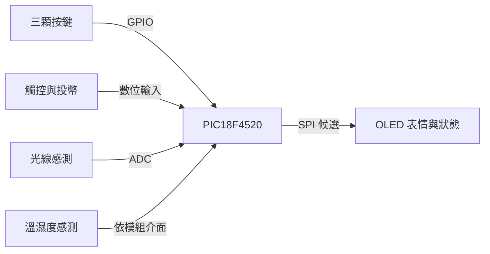

# 主題三｜PIC18F4520 感測互動電子寵物

> 專題規劃草案｜五人小組｜以 PIC18F4520 為唯一主控制器。先完成螢幕養成，再改版成桌上型電子雞。

> 圖為外觀與功能示意，並非已完成的作品或電路圖。

## 1. 專題動機與操作體驗

我們想做一隻能從蛋孵化、會表達需求，也會對實體互動有反應的電子雞。第一版用 OLED 和三顆按鍵完成養成，等照顧、成長和畫面都能正常運作，再逐項加入感測器。桌上版沿用同一套程式，把撫摸區、餵食口與各感測器整合到小雞外殼。

| 基本功能 | 玩家看到的結果 |
|---|---|
| 孵化與成長 | 蛋 → 小雞 → 成雞，累積照顧成果後進入下一階段 |
| 養成狀態 | 畫面顯示飽食度、開心度、體力。長時間沒照顧時依規則變化 |
| 按鍵操作 | 左、右、確認三鍵，用於選擇餵食、玩耍、睡覺 |
| 動作回饋 | 餵食時吃飼料、玩耍時變開心、睡覺時閉眼並回復體力 |
| 迷你遊戲 | 基礎養成穩定後加入「接飼料」，成功會增加開心度 |

## 2. 五項硬體互動

五項都先列入預計目標。先在桌上原型測試，再決定外殼如何配置。

| 功能 | 感測做法 | 遊戲反應 | 驗收方式 |
|---|---|---|---|
| **溫度** | 溫濕度模組讀取周圍氣溫 | 冷時發抖、熱時冒汗，舒適時恢復 | 觀察讀值與狀態切換是否一致，臨界值附近不反覆閃動 |
| **撫摸** | 電容觸控片貼在頭部內側 | 顯示愛心，開心度增加 | 觸碰一次只觸發一次，移開後才能再次觸發 |
| **投幣餵食** | 槽型光遮斷感測器偵測代幣通過 | 播放吃飼料動畫並補充飽食度 | 代幣通過一次只餵食一次，卡住不連續加分 |
| **日曬** | 光敏電阻分壓接 ADC，量環境光 | 亮時顯示太陽，暗時切換夜間畫面 | 用手電筒照射與遮光重複測試 |
| **下雨／濕度** | 溫濕度模組讀取空氣濕度 | 濕度偏高時顯示潮濕或撐傘場景 | 用另一處較潮濕的空氣測試，並核對讀值與門檻 |

> 濕度只能用來觸發「下雨情境」，不能判定真的有雨滴。要做實際雨滴偵測，再另外使用獨立感測片。

## 3. 系統架構與程式分工

- **一次性事件**：按鍵、撫摸和代幣通過都轉成遊戲事件，再交給同一套狀態更新程式。先處理去彈跳或重複觸發，再加減數值。
- **持續環境狀態**：溫度、亮度、濕度定期取樣。以不同進入和退出門檻，或要求連續多次符合條件，避免畫面在臨界值反覆切換。
- **畫面優先順序**：先播玩家操作的短動畫，再回到對應的環境畫面。例如雨天投幣時先讓小雞吃飯，吃完才回到撐傘畫面。
- **課程單元對應**：Timer 排程養成數值與動畫，Interrupt 用於 Timer 中斷，ADC 讀光敏電阻。若使用 SPI 版 OLED，可另外展示 PIC 的硬體 SPI 傳輸。中斷只更新時基或設旗標，顯示和感測讀取留在主程式。
- **記憶體規劃**：第一版角色用單色點陣素材，放在程式 Flash。視畫面大小採逐頁或局部更新，不先加外部記憶體。關機存檔與關機期間的計時屬於後續擴充。

## 4. 設備需求與取得方式

| 設備 | 數量 | 取得方式／查找關鍵字 |
|---|---:|---|
| PIC18F4520 與燒錄器 | 1 組 | 優先借用課程設備，確認剩餘腳位 |
| 小型單色 OLED | 1 | 搜尋「SPI OLED 顯示模組」，確認通訊方式與電壓 |
| 操作按鍵 | 3 | 電子材料行、系上實驗室 |
| 電容觸控模組 | 1 | 搜尋「電容觸控模組」，先試外殼材料與厚度 |
| 槽型光遮斷感測器 | 1 | 搜尋「槽型光電開關」，依代幣厚度選槽寬 |
| 光敏電阻與分壓電阻 | 1 組 | 電子材料行或既有實驗材料 |
| 溫濕度感測模組 | 1 | 搜尋「數位溫濕度模組」，核對介面、供電與邏輯電壓 |
| 麵包板、線材、電源 | 1 組 | 校內借用或電子材料行 |
| 小雞外殼、餵食口、回收槽 | 1 組 | 初版用紙板驗證尺寸，桌上版再以校內 3D 列印或手作製作 |
| 可回收代幣 | 3～5 枚 | 自製等尺寸代幣，無須辨識真實硬幣或面額 |

價格與庫存待小組詢價，採購前先核對模組的供電、訊號電壓與接腳。

## 5. 開發流程與驗收

| 階段 | 開發內容 | 驗收目標 |
|---|---|---|
| 1. 螢幕原型 | OLED、三鍵、Timer、主畫面與選單 | 能操作選單並看見角色及養成狀態 |
| 2. 完成養成 | 餵食、玩耍、睡覺、孵化與成長 | 不接感測器也能從蛋養成成雞 |
| 3. 加入實體互動 | 撫摸與投幣獨立測試，再接到養成事件 | 摸一下有愛心，投一枚代幣餵食一次 |
| 4. 加入環境感測 | 溫度、光線與濕度逐項接入 | 三種讀值各有明確、可重複展示的畫面反應 |
| 5. 改版為桌上型 | 螢幕與按鍵固定、頭頂觸控、餵食口及代幣回收槽 | 外殼裝好後仍能感測，代幣取回不用拆殼 |
| 6. 整合與展示 | 邊界測試、加速展示、文件與影片 | 展示孵化、照顧、感測互動與成長，保留測試紀錄 |

若進度不足，先保留**完整螢幕養成、撫摸與投幣**。溫度、光線和濕度可以先只改背景或表情，不改養成數值。外殼尚未完成時仍可用桌面原型展示。

## 6. 五人分工

| 組員 | 角色 | 主要任務與交付物 |
|---|---|---|
| A｜姓名待填 | 硬體一 | 主控、OLED、按鍵與電源。交付電路圖、接腳表與桌面原型 |
| B｜姓名待填 | 硬體二 | 感測器、投幣機構與外殼。交付模組測試、外殼和回收槽 |
| C｜姓名待填 | 軟體一 | Timer、養成狀態、成長規則與事件處理。交付養成程式與測試案例 |
| D｜姓名待填 | 軟體二 | OLED 介面、角色像素圖、動畫、感測回饋及迷你遊戲。交付畫面素材與顯示程式 |
| E｜姓名待填 | 軟硬體整合 | 統一模組介面、測試感測器與畫面同時運作、統整文件與 Demo |

## 7. Demo 與繳交

**Demo 順序**：顯示孵化 → 撫摸出現愛心 → 投幣播放餵食動畫 → 示範光線、溫度或濕度如何改變畫面 → 顯示成長結果。可用加速模式縮短成長等待，並明確標示這是展示設定。

- 一頁提案：專題動機、功能原理、初步架構、五人分工。
- 十頁內系統文件：使用對象、完整架構與流程圖、實際電路、工具與材料、介面與程式、分工、問題及測試結果。
- 程式碼壓縮檔與 Demo 影片：標明可執行或燒錄的版本、所用工具及接線。

## 8. 放到 HackMD 或 GitHub

- **HackMD**：把本檔內容貼進新筆記。上傳概念圖後，以 HackMD 產生的圖片網址取代 `assets/electronic-pet-concept.png`。
- **GitHub**：把 `README.md` 和 `assets/` 一起放到儲存庫根目錄，保留相對路徑。這個起始包是專題規劃，尚未包含實作韌體。
